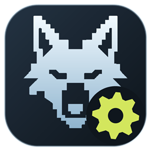
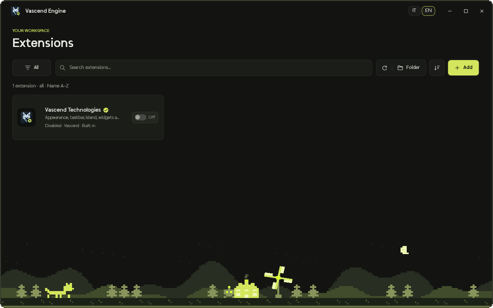
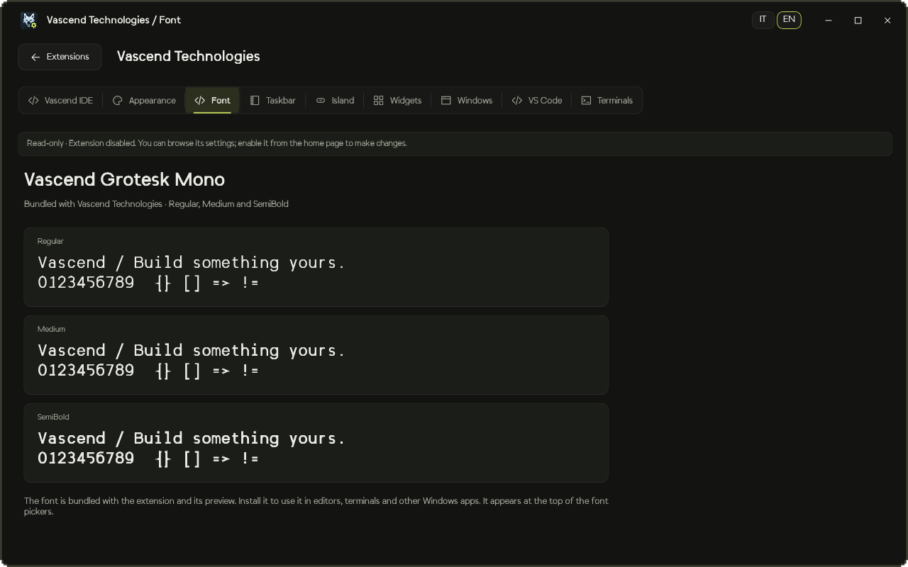

<div align="center">
  
  <h1>Vascend Engine</h1>
  <p><strong>Your desktop. Your extensions. Your AI agents.</strong></p>
  <p>A native Windows workspace for desktop customization, community extensions and AI agent integrations.</p>
  <p>Windows x64 · .NET 8 · WPF · English / Italiano</p>
  <p>
    <a href="#getting-started">Getting started</a> ·
    <a href="#community-extensions">Extensions</a> ·
    <a href="#development">Development</a> ·
    <a href="#contributing">Contributing</a>
  </p>
</div>



Vascend Engine brings your Windows desktop and AI agent integrations into one extensible app. Browse installed extensions, connect a GitHub repository, choose what to enable and configure your workspace from a single place.

The built-in **Vascend Technologies** extension includes desktop appearance, a custom taskbar, the island, widgets, editor and terminal settings, and integrations that surface Claude usage and Vascend IDE agent activity. It is verified and **disabled by default**: you choose when to enable it.

## Features

| Area | What you can do |
| --- | --- |
| Extension catalog | Search, filter and sort extensions; enable or disable them from their cards. |
| GitHub plugins | Install from a public repository URL or `owner/repository`, select plugins from a repository and prepare updates. |
| Conflict checks | Detect declared incompatibilities and overlapping exclusive resources before enabling an extension. |
| Desktop customization | Configure appearance, taskbar position, the island, Windows settings, editors and terminals. |
| Widgets | Choose Classic, Editorial, Terminal or Glass styles and personalize the name below the clock. |
| AI agents | Surface Claude usage and Vascend IDE agent activity through the desktop integration. |
| Bundled typography | Preview and install Vascend Grotesk Mono in Regular, Medium and SemiBold. |
| Interface | Dark Vascend colors, custom vector icons, morph animations and animated pixel scenery. |
| Read-only browsing | Inspect a disabled extension's settings without applying changes. |
| Languages | Switch between English and Italian from the title bar; the choice is saved locally. |

## Getting started

### Requirements

- **Windows 10 version 2004 or newer**, x64.
- **.NET 8 SDK** to build from source.
- **.NET Desktop Runtime 8 x64** to run the framework-dependent build.
- Git to clone the repository.

Desktop integrations depend on the corresponding apps being installed. The Wi-Fi connection-quality API and some Windows features depend on OS and driver support.

### Build and install

Run these commands in **PowerShell on Windows**:

```powershell
git clone https://github.com/VascendTechnologies/vascend-engine.git
cd vascend-engine
.\tools\install.ps1
```

Close Vascend Engine and its desktop component before installing. The script builds both projects, backs up existing application binaries and installs the app under your Windows user profile. Existing preferences are preserved; extensions and automatic startup are not enabled by the installer.

Launch Engine:

```powershell
& "$env:USERPROFILE\.config\vascend-engine\bin\VascendEngine.exe"
```

Open an extension card to inspect its settings. Use its switch to enable it. To change the interface language, choose **EN** or **IT** in the title bar.

### Build without installing

```powershell
dotnet build .\VascendEngine.sln -c Release
.\tools\build.ps1
```

Published output is written to `artifacts/engine` and `artifacts/desktop`. The .NET runtime is not bundled.

## Community extensions

### Install from GitHub

1. Open **Add → From GitHub repository**.
2. Paste a public GitHub repository URL or `owner/repository`.
3. Optionally select a branch, tag or commit.
4. Choose **Find plugins**, then **Install** on the plugin you want.
5. Return to the catalog and enable its card.

New installations start disabled. Engine remembers the repository and commit so you can check for updates from **Connected repositories**. Updates are staged and applied on the next app launch; user settings are kept separately.

You can also install a local folder using **Add → From local folder**.

### Create an extension

An extension starts with an `extension.json` file:

```json
{
  "apiVersion": 1,
  "id": "community.my-extension",
  "name": "My extension",
  "version": "1.0.0",
  "author": "Your name",
  "description": "A settings page for my extension.",
  "settings": [
    {
      "key": "enabled",
      "label": "Enable feature",
      "type": "boolean",
      "default": true
    }
  ],
  "conflictsWith": [],
  "exclusiveResources": []
}
```

Publish the manifest at the repository root, or put multiple plugins in separate subfolders. A declarative manifest produces a settings page. Custom behavior and WPF pages require a prebuilt DLL implementing `IEngineExtension`; Engine does not compile repository code or run installation scripts.

Start with the [example extension](examples/community-example) and read the [extension API guide](docs/EXTENSIONS.md) for settings, native pages, lifecycle hooks, conflict declarations and restoration.

**Trust matters:** native plugins run with your Windows user permissions. Conflict detection relies on accurate declarations; it cannot infer every side effect of arbitrary code. Claude Code plugins use a different format and are not directly compatible with Engine.

## Disabling and restoring settings

The built-in extension can be disabled without discarding its saved configuration. Its settings remain available in read-only mode.

When disabling it, Engine offers **Disable only** or **Disable and restore**. Depending on the options and backups available, you can restore the Windows taskbar, remove Vascend automatic startup, and restore app theme and font settings from previous backups. Widget configurations and Windows colors remain saved.



Third-party plugins can provide their own restoration hook. Older native plugins that do not support live deactivation may require an Engine restart to stop previously loaded code.

## Development

```text
apps/
  vascend-engine/src/     WPF host, catalog, localization and plugin management
  barra-vascend/src/      Taskbar, island, widgets and shared models
  barra-vascend/assets/   Desktop component icons
assets/scripts/          Windows taskbar support
docs/                    Extension documentation and screenshots
examples/                Example plugin
tests/                   Windows smoke checks
tools/                   Build, installation and test scripts
```

The projects share selected C# files through relative references. Both projects must remain in this layout.

### Localization

Interface source strings are Italian; English translations live in [`Assets/Locales/en.json`](apps/vascend-engine/src/Assets/Locales/en.json). The host updates visible labels and menus when the language changes, while identifiers, persisted setting keys, extension metadata and user-entered values remain unchanged.

Plugin authors control their own custom pages and translations. `ExtensionContext.Language` exposes the host's selected language.

### Optional integrations

| Variable | Purpose |
| --- | --- |
| `CLAUDE_CONFIG_DIR` | Claude configuration directory. Defaults to `.claude` under the Windows user profile. |
| `VASCEND_WSL_DISTRO` | WSL distribution used by shortcuts. Defaults to `Ubuntu`. |
| `VASCEND_WSL_HOME` | Full UNC path to the Linux home directory when it differs from the Windows username. |

Claude and Vascend IDE integrations are optional. Engine does not bundle AI model access, subscriptions or credentials.

### Local data

Settings and extension state are stored under `%USERPROFILE%\.config\vascend-engine`. Runtime state, credentials, logs, caches and build output are excluded from version control.

## Contributing

Bug reports, extension ideas and improvements are welcome through [GitHub Issues](https://github.com/VascendTechnologies/vascend-engine/issues) and pull requests.

For a bug report, include your Windows version, the affected extension, reproduction steps and the expected result. Remove personal information and credentials from logs or screenshots before attaching them.

For code changes, build the Windows solution and run the smoke checks before opening a pull request:

```powershell
.\tools\test.ps1
```

## License

A public repository does not by itself grant an open-source license. No open-source license is currently provided for this project. Vascend code, branding, graphics and fonts retain their respective ownership.
